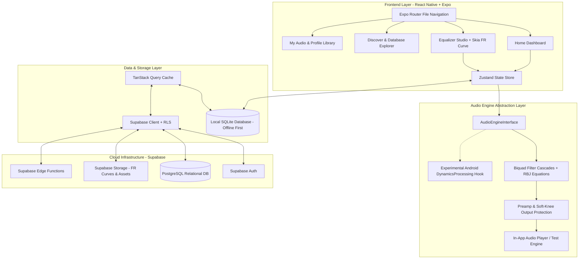

# Audiophile Architecture & Technical Decisions

## 1. Executive System Overview

The Audiophile application is engineered as an Android-first mobile platform combining high-fidelity digital signal processing (DSP) with a sleek, reactive user interface and cloud synchronization.



---

## 2. Audio Processing Architecture & DSP Engine

### 2.1 DSP Pipeline

```
Raw Audio Stream (PCM)
      │
      ▼
┌──────────────┐
│ Gain Stage   │  (Preamp: attenuates by max positive filter peak to preserve 0 dBFS headroom)
└──────┬───────┘
      │
      ▼
┌──────────────┐
│ Biquad EQ    │  (Cascaded Second-Order IIR Biquad Filters: Bands 1..N)
│ Cascade      │  (Direct Form II Transposed structure for numerical stability)
└──────┬───────┘
      │
      ▼
┌──────────────┐
│ Output Guard │  (Soft-knee peak limiter prevents digital overs/inter-sample clipping)
└──────┬───────┘
      │
      ▼
DAC / Audio Output
```

### 2.2 Mathematical Foundation: RBJ Audio EQ Cookbook

Every parametric filter stage is evaluated as a second-order Infinite Impulse Response (IIR) transfer function in the $z$-domain:

$$H(z) = \frac{b_0 + b_1 z^{-1} + b_2 z^{-2}}{a_0 + a_1 z^{-1} + a_2 z^{-2}}$$

Normalized form computed in DSP processing:

$$y[n] = \frac{b_0}{a_0}x[n] + \frac{b_1}{a_0}x[n-1] + \frac{b_2}{a_0}x[n-2] - \frac{a_1}{a_0}y[n-1] - \frac{a_2}{a_0}y[n-2]$$

#### Intermediate Variables:
- $\omega_0 = 2\pi \cdot \frac{f_0}{F_s}$ (Angular frequency normalized to sample rate $F_s$)
- $\alpha = \frac{\sin(\omega_0)}{2Q}$
- $A = 10^{\frac{\text{gain}_{\text{dB}}}{40}} = \sqrt{10^{\frac{\text{gain}_{\text{dB}}}{20}}}$

#### Standard Coefficient Formulas:

1. **Peaking EQ (Bell):**
   - $b_0 = 1 + \alpha \cdot A$
   - $b_1 = -2 \cos(\omega_0)$
   - $b_2 = 1 - \alpha \cdot A$
   - $a_0 = 1 + \frac{\alpha}{A}$
   - $a_1 = -2 \cos(\omega_0)$
   - $a_2 = 1 - \frac{\alpha}{A}$

2. **Low Shelf:**
   - $b_0 = A \left((A + 1) - (A - 1)\cos(\omega_0) + 2\sqrt{A}\alpha\right)$
   - $b_1 = 2A \left((A - 1) - (A + 1)\cos(\omega_0)\right)$
   - $b_2 = A \left((A + 1) - (A - 1)\cos(\omega_0) - 2\sqrt{A}\alpha\right)$
   - $a_0 = (A + 1) + (A - 1)\cos(\omega_0) + 2\sqrt{A}\alpha$
   - $a_1 = -2 \left((A - 1) + (A + 1)\cos(\omega_0)\right)$
   - $a_2 = (A + 1) + (A - 1)\cos(\omega_0) - 2\sqrt{A}\alpha$

3. **High Shelf:**
   - $b_0 = A \left((A + 1) + (A - 1)\cos(\omega_0) + 2\sqrt{A}\alpha\right)$
   - $b_1 = -2A \left((A - 1) + (A + 1)\cos(\omega_0)\right)$
   - $b_2 = A \left((A + 1) + (A - 1)\cos(\omega_0) - 2\sqrt{A}\alpha\right)$
   - $a_0 = (A + 1) - (A - 1)\cos(\omega_0) + 2\sqrt{A}\alpha$
   - $a_1 = 2 \left((A - 1) - (A + 1)\cos(\omega_0)\right)$
   - $a_2 = (A + 1) - (A - 1)\cos(\omega_0) - 2\sqrt{A}\alpha$

4. **Low Pass (Second-order Butterworth Q = 0.7071):**
   - $b_0 = \frac{1 - \cos(\omega_0)}{2}$
   - $b_1 = 1 - \cos(\omega_0)$
   - $b_2 = \frac{1 - \cos(\omega_0)}{2}$
   - $a_0 = 1 + \alpha$
   - $a_1 = -2\cos(\omega_0)$
   - $a_2 = 1 - \alpha$

5. **High Pass (Second-order Butterworth Q = 0.7071):**
   - $b_0 = \frac{1 + \cos(\omega_0)}{2}$
   - $b_1 = -(1 + \cos(\omega_0))$
   - $b_2 = \frac{1 + \cos(\omega_0)}{2}$
   - $a_0 = 1 + \alpha$
   - $a_1 = -2\cos(\omega_0)$
   - $a_2 = 1 - \alpha$

6. **Notch:**
   - $b_0 = 1$
   - $b_1 = -2\cos(\omega_0)$
   - $b_2 = 1$
   - $a_0 = 1 + \alpha$
   - $a_1 = -2\cos(\omega_0)$
   - $a_2 = 1 - \alpha$

### 2.3 Parameter Smoothing & Glitch Prevention (De-Zippering)
Directly swapping filter coefficients during active playback causes phase discontinuity and audible clicks ("zipper noise"). The engine implements:
- **Parameter Slew-Rate Limiting**: Target parameters ($f_c, \text{Gain}, Q$) are interpolated over a ramp window (5 ms - 20 ms) per audio buffer.
- **Double-Buffering State Variables**: Filter state history ($w_1, w_2$ in Direct Form II Transposed) is preserved seamlessly across coefficient recalculations to guarantee zero DC offset jump.

### 2.4 Headroom Management & Clipping Prevention
When applying positive gain boosts:
$$\text{MaxPeakGain} = \max_{f \in [20, 20000]} |H_{\text{total}}(f)|$$
- **Auto-Preamp Option**: Calculates $\text{Preamp} = -\max(0, \text{MaxPeakGain})$, guaranteeing that combined transfer function does not exceed $0\text{ dBFS}$.
- **Soft-Knee Limiter**: Sits at the final stage before digital-to-analog conversion. If unpredicted inter-sample peaks exceed $-0.1\text{ dBFS}$, a smooth polynomial saturation curve is engaged to avoid harsh digital clipping.

---

## 3. Audio Engine Abstraction Layer

To ensure frontend isolation and testability, the audio processing layer exposes a strict TypeScript contract:

```typescript
export type FilterType = 
  | 'peak'
  | 'low_shelf'
  | 'high_shelf'
  | 'low_pass'
  | 'high_pass'
  | 'notch';

export interface BiquadFilterConfig {
  id: string;
  type: FilterType;
  frequency: number;   // 20 Hz - 20,000 Hz
  gain: number;        // -24 dB to +24 dB
  q: number;           // 0.1 to 18.0
  enabled: boolean;
}

export interface AudioEngineState {
  isPlaying: boolean;
  currentPositionMs: number;
  durationMs: number;
  sampleRate: number;
  preampDb: number;
  filters: BiquadFilterConfig[];
  isBypassed: boolean;
  isAutoPreampEnabled: boolean;
  peakOutputLevel: number;
  isClipping: boolean;
}

export interface IAudioEngine {
  initialize(sampleRate?: number): Promise<void>;
  loadSource(uri: string): Promise<void>;
  play(): Promise<void>;
  pause(): Promise<void>;
  seek(positionMs: number): Promise<void>;
  setPreamp(gainDb: number): void;
  setAutoPreamp(enabled: boolean): void;
  setFilter(index: number, config: Partial<BiquadFilterConfig>): void;
  setAllFilters(filters: BiquadFilterConfig[]): void;
  enableFilter(index: number, enabled: boolean): void;
  bypassEQ(bypass: boolean): void;
  getCalculatedFrequencyResponse(frequencies: number[]): number[];
  getEngineState(): AudioEngineState;
  subscribeToState(listener: (state: AudioEngineState) => void): () => void;
  release(): Promise<void>;
}
```

---

## 4. Dual-Approach Audio Processing Strategy

### Approach 1: High-Fidelity In-App Processing (MVP & Core Engine)
- Dedicated playback pipeline within the app using high-resolution audio sources (FLAC, WAV, AAC, MP3, pink noise sweeps, frequency response test tones).
- Audio buffer processing runs through the Biquad DSP cascade in 64-bit floating point precision.
- Zero latency feedback for tuning verification, A/B comparisons, and listening tests.

### Approach 2: System-Wide Android Integration (Experimental & Capability-Gated)
- **Android OS Reality**: Android security model restricts arbitrary apps from intercepting audio output from external apps (Spotify, YouTube, Apple Music, Tidal).
- **Available Mechanisms**:
  1. `android.media.audiofx.DynamicsProcessing` (API 28+): Supports multi-band parametric equalization, but only when bound to an existing `audioSessionId`.
  2. `AudioPlaybackCapture` (Android 10+): Allows audio capture from other apps only if those apps permit capture via `AudioAttributes.ALLOW_CAPTURE_BY_ALL` (most DRM/commercial streaming apps set `USAGE_MEDIA` with flags that forbid capture).
  3. Broadcast Audio Sessions: Media players that explicitly broadcast their audio session IDs via intent (e.g., Poweramp, PlayerPro) can be targeted.
- **Audiophile Policy**: The application will perform dynamic device capability detection. It will clearly indicate to the user whether system-wide tuning is supported on their device / target app, avoiding misleading promises.

---

## 5. Macro Audio Knobs to DSP Mapping

Audiophile features intuitive rotary knobs for rapid tuning without requiring manual filter entry. Each knob maps to calibrated acoustic bands:

| Knob | Acoustic Focus | DSP Filter Mapping |
|---|---|---|
| **Bass** | Sub-bass & thump | Low Shelf at 105 Hz ($Q = 0.71$) + Peaking at 45 Hz ($Q = 1.2$) |
| **Midrange** | Fundamental body | Wide Peaking at 800 Hz ($Q = 0.8$) to 1.4 kHz |
| **Treble** | Detail & shimmer | High Shelf at 8,000 Hz ($Q = 0.71$) + Peaking at 12,000 Hz ($Q = 1.5$) |
| **Clarity** | Vocal articulation & snare snap | Peaking at 3,500 Hz ($Q = 1.4$) |
| **Warmth** | Fullness vs boominess | Gentle Peaking / Tilt at 250 Hz ($Q = 0.9$) |
| **Vocal Presence** | Pinna gain region / Forwardness | Peaking at 2,200 Hz ($Q = 1.1$) |
| **Soundstage** | Perceived width & localization | Supported stereo processing (Bauer Crossfeed / subtle inter-aural time difference), **never** fake EQ boosts |

---

## 6. Offline-First & Cloud Synchronization Architecture

- **Primary Local Storage**: `expo-sqlite` stores all IEM models, measurements, custom profiles, and settings locally. The app functions completely without internet access.
- **Sync Engine**: TanStack Query + Supabase client with an optimistic mutations pattern.
  - Profile creation or edits write immediately to local SQLite.
  - Background worker pushes pending mutations to Supabase when connectivity is restored.
  - Conflict resolution: Last-Write-Wins (LWW) based on monotonic timestamp, with manual conflict resolution if cloud version has diverged.
- **Security & Row Level Security (RLS)**:
  - Users can read all public curated and community profiles.
  - Users can only edit or delete their own custom profiles.
  - Service-role credentials are strictly kept on backend Edge Functions; mobile client runs with anonymous/authenticated user JWTs.

