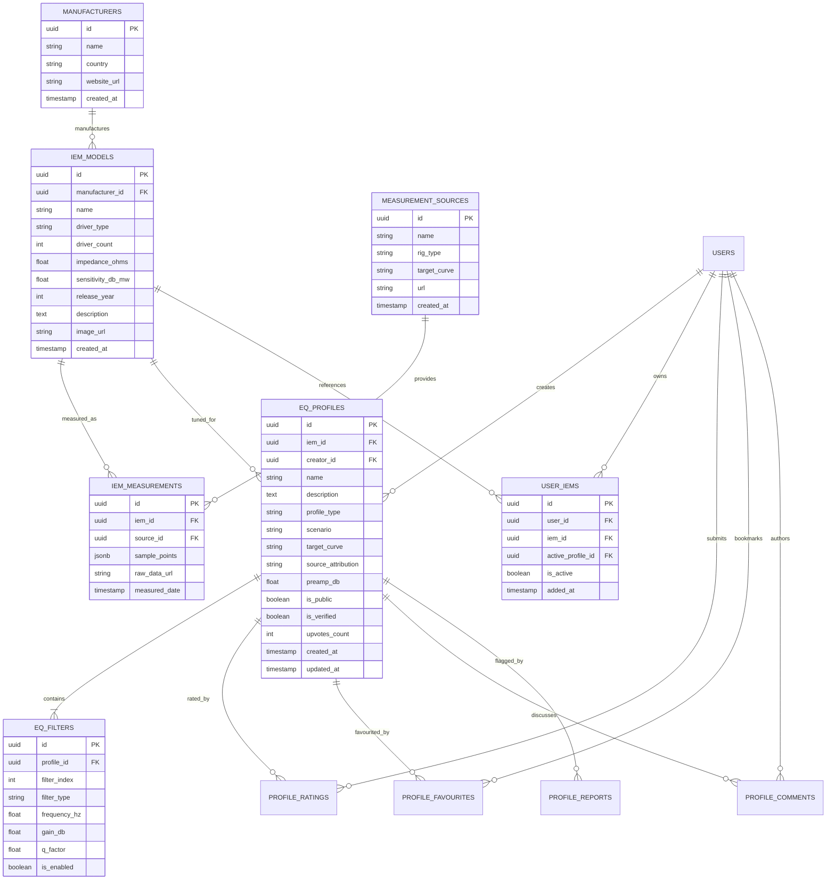

# Audiophile Data Models & Database Design

## 1. Entity-Relationship Diagram



---

## 2. PostgreSQL Schema & DDL

```sql
-- 1. EXTENSIONS
CREATE EXTENSION IF NOT EXISTS "uuid-ossp";

-- 2. MANUFACTURERS
CREATE TABLE manufacturers (
    id UUID PRIMARY KEY DEFAULT uuid_generate_v4(),
    name VARCHAR(100) NOT NULL UNIQUE,
    country VARCHAR(60),
    website_url TEXT,
    created_at TIMESTAMPTZ DEFAULT NOW()
);

-- 3. IEM MODELS
CREATE TABLE iem_models (
    id UUID PRIMARY KEY DEFAULT uuid_generate_v4(),
    manufacturer_id UUID NOT NULL REFERENCES manufacturers(id) ON DELETE CASCADE,
    name VARCHAR(150) NOT NULL,
    driver_type VARCHAR(50) NOT NULL, -- 'Dynamic', 'Planar', 'BA', 'Hybrid', 'Tribrid', 'EST'
    driver_count INTEGER DEFAULT 1,
    impedance_ohms NUMERIC(6, 2) NOT NULL,
    sensitivity_db_mw NUMERIC(6, 2) NOT NULL,
    release_year INTEGER,
    description TEXT,
    image_url TEXT,
    created_at TIMESTAMPTZ DEFAULT NOW(),
    CONSTRAINT uq_manufacturer_iem UNIQUE (manufacturer_id, name)
);

-- 4. MEASUREMENT SOURCES
CREATE TABLE measurement_sources (
    id UUID PRIMARY KEY DEFAULT uuid_generate_v4(),
    name VARCHAR(100) NOT NULL, -- e.g. 'Crinacle 711', 'Squiglink', 'SoundGuys 5128'
    rig_type VARCHAR(80) NOT NULL, -- 'IEC60318-4 (711)', 'B&K 5128', 'GRAS 43AG'
    target_curve VARCHAR(100) NOT NULL, -- 'Harman In-Ear 2019v2', 'IEF Neutral 2023', 'Diffuse Field'
    url TEXT,
    created_at TIMESTAMPTZ DEFAULT NOW()
);

-- 5. IEM MEASUREMENTS
CREATE TABLE iem_measurements (
    id UUID PRIMARY KEY DEFAULT uuid_generate_v4(),
    iem_id UUID NOT NULL REFERENCES iem_models(id) ON DELETE CASCADE,
    source_id UUID NOT NULL REFERENCES measurement_sources(id) ON DELETE RESTRICT,
    sample_points JSONB NOT NULL, -- Array of [frequency_hz, spl_db]: [[20, 85.2], [21, 85.3], ...]
    raw_data_url TEXT,
    measured_date DATE,
    created_at TIMESTAMPTZ DEFAULT NOW()
);

-- 6. EQ PROFILES
CREATE TYPE eq_profile_type AS ENUM (
    'curated',
    'measurement_derived',
    'community',
    'user_custom'
);

CREATE TYPE eq_scenario AS ENUM (
    'music_balanced',
    'music_bass',
    'music_vocal',
    'music_classical',
    'gaming_fps',
    'movie_cinema',
    'podcast_speech',
    'custom'
);

CREATE TABLE eq_profiles (
    id UUID PRIMARY KEY DEFAULT uuid_generate_v4(),
    iem_id UUID REFERENCES iem_models(id) ON DELETE CASCADE,
    creator_id UUID REFERENCES auth.users(id) ON DELETE SET NULL,
    name VARCHAR(120) NOT NULL,
    description TEXT,
    profile_type eq_profile_type NOT NULL DEFAULT 'user_custom',
    scenario eq_scenario NOT NULL DEFAULT 'music_balanced',
    target_curve VARCHAR(100),
    source_attribution TEXT,
    preamp_db NUMERIC(5, 2) NOT NULL DEFAULT 0.00,
    is_public BOOLEAN NOT NULL DEFAULT FALSE,
    is_verified BOOLEAN NOT NULL DEFAULT FALSE,
    upvotes_count INTEGER NOT NULL DEFAULT 0,
    created_at TIMESTAMPTZ DEFAULT NOW(),
    updated_at TIMESTAMPTZ DEFAULT NOW()
);

-- 7. EQ FILTERS
CREATE TYPE eq_filter_type AS ENUM (
    'peak',
    'low_shelf',
    'high_shelf',
    'low_pass',
    'high_pass',
    'notch'
);

CREATE TABLE eq_filters (
    id UUID PRIMARY KEY DEFAULT uuid_generate_v4(),
    profile_id UUID NOT NULL REFERENCES eq_profiles(id) ON DELETE CASCADE,
    filter_index INTEGER NOT NULL,
    filter_type eq_filter_type NOT NULL,
    frequency_hz NUMERIC(8, 2) NOT NULL CHECK (frequency_hz >= 20 AND frequency_hz <= 20000),
    gain_db NUMERIC(5, 2) NOT NULL CHECK (gain_db >= -24.0 AND gain_db <= 24.0),
    q_factor NUMERIC(6, 3) NOT NULL CHECK (q_factor >= 0.1 AND q_factor <= 20.0),
    is_enabled BOOLEAN NOT NULL DEFAULT TRUE,
    CONSTRAINT uq_profile_filter_index UNIQUE (profile_id, filter_index)
);

-- 8. USER SAVED IEMS
CREATE TABLE user_iems (
    id UUID PRIMARY KEY DEFAULT uuid_generate_v4(),
    user_id UUID NOT NULL REFERENCES auth.users(id) ON DELETE CASCADE,
    iem_id UUID NOT NULL REFERENCES iem_models(id) ON DELETE CASCADE,
    active_profile_id UUID REFERENCES eq_profiles(id) ON DELETE SET NULL,
    is_active BOOLEAN NOT NULL DEFAULT FALSE,
    added_at TIMESTAMPTZ DEFAULT NOW(),
    CONSTRAINT uq_user_iem UNIQUE (user_id, iem_id)
);

-- 9. PROFILE RATINGS & FAVOURITES
CREATE TABLE profile_ratings (
    id UUID PRIMARY KEY DEFAULT uuid_generate_v4(),
    profile_id UUID NOT NULL REFERENCES eq_profiles(id) ON DELETE CASCADE,
    user_id UUID NOT NULL REFERENCES auth.users(id) ON DELETE CASCADE,
    rating SMALLINT NOT NULL CHECK (rating >= 1 AND rating <= 5),
    created_at TIMESTAMPTZ DEFAULT NOW(),
    CONSTRAINT uq_profile_user_rating UNIQUE (profile_id, user_id)
);

CREATE TABLE profile_favourites (
    id UUID PRIMARY KEY DEFAULT uuid_generate_v4(),
    profile_id UUID NOT NULL REFERENCES eq_profiles(id) ON DELETE CASCADE,
    user_id UUID NOT NULL REFERENCES auth.users(id) ON DELETE CASCADE,
    created_at TIMESTAMPTZ DEFAULT NOW(),
    CONSTRAINT uq_profile_user_fav UNIQUE (profile_id, user_id)
);

-- 10. PROFILE REPORTS (MODERATION)
CREATE TABLE profile_reports (
    id UUID PRIMARY KEY DEFAULT uuid_generate_v4(),
    profile_id UUID NOT NULL REFERENCES eq_profiles(id) ON DELETE CASCADE,
    reporter_id UUID NOT NULL REFERENCES auth.users(id) ON DELETE SET NULL,
    reason TEXT NOT NULL,
    status VARCHAR(30) NOT NULL DEFAULT 'pending', -- 'pending', 'resolved', 'dismissed'
    created_at TIMESTAMPTZ DEFAULT NOW()
);
```

---

## 3. Row Level Security (RLS) Policies

```sql
-- Enable RLS on all tables
ALTER TABLE manufacturers ENABLE ROW LEVEL SECURITY;
ALTER TABLE iem_models ENABLE ROW LEVEL SECURITY;
ALTER TABLE measurement_sources ENABLE ROW LEVEL SECURITY;
ALTER TABLE iem_measurements ENABLE ROW LEVEL SECURITY;
ALTER TABLE eq_profiles ENABLE ROW LEVEL SECURITY;
ALTER TABLE eq_filters ENABLE ROW LEVEL SECURITY;
ALTER TABLE user_iems ENABLE ROW LEVEL SECURITY;
ALTER TABLE profile_ratings ENABLE ROW LEVEL SECURITY;
ALTER TABLE profile_favourites ENABLE ROW LEVEL SECURITY;
ALTER TABLE profile_reports ENABLE ROW LEVEL SECURITY;

-- Read Policies: Public items are readable by any authenticated or anonymous user
CREATE POLICY "Public read for manufacturers" ON manufacturers FOR SELECT USING (true);
CREATE POLICY "Public read for iem_models" ON iem_models FOR SELECT USING (true);
CREATE POLICY "Public read for measurement_sources" ON measurement_sources FOR SELECT USING (true);
CREATE POLICY "Public read for iem_measurements" ON iem_measurements FOR SELECT USING (true);

-- EQ Profiles: Public profiles or owned profiles are visible
CREATE POLICY "Read eq_profiles" ON eq_profiles FOR SELECT
    USING (is_public = true OR auth.uid() = creator_id);

CREATE POLICY "Insert own eq_profiles" ON eq_profiles FOR INSERT
    WITH CHECK (auth.uid() = creator_id);

CREATE POLICY "Update own eq_profiles" ON eq_profiles FOR UPDATE
    USING (auth.uid() = creator_id);

CREATE POLICY "Delete own eq_profiles" ON eq_profiles FOR DELETE
    USING (auth.uid() = creator_id);

-- EQ Filters: Follow parent profile visibility
CREATE POLICY "Read eq_filters" ON eq_filters FOR SELECT
    USING (EXISTS (
        SELECT 1 FROM eq_profiles p 
        WHERE p.id = eq_filters.profile_id 
        AND (p.is_public = true OR p.creator_id = auth.uid())
    ));

CREATE POLICY "Manage own eq_filters" ON eq_filters FOR ALL
    USING (EXISTS (
        SELECT 1 FROM eq_profiles p 
        WHERE p.id = eq_filters.profile_id 
        AND p.creator_id = auth.uid()
    ));

-- User IEMs: strictly per user
CREATE POLICY "Users manage own iems" ON user_iems FOR ALL
    USING (auth.uid() = user_id);

-- Ratings and Favourites
CREATE POLICY "Users manage own ratings" ON profile_ratings FOR ALL
    USING (auth.uid() = user_id);

CREATE POLICY "Users manage own favourites" ON profile_favourites FOR ALL
    USING (auth.uid() = user_id);
```

---

## 4. Local SQLite Offline Schema

The local SQLite schema provides an offline copy of the database and tracks synchronization status:

```sql
CREATE TABLE IF NOT EXISTS local_iems (
    id TEXT PRIMARY KEY,
    manufacturer_name TEXT NOT NULL,
    model_name TEXT NOT NULL,
    driver_type TEXT NOT NULL,
    driver_count INTEGER DEFAULT 1,
    impedance_ohms REAL NOT NULL,
    sensitivity_db_mw REAL NOT NULL,
    image_url TEXT,
    is_saved_to_library INTEGER DEFAULT 0,
    is_active INTEGER DEFAULT 0
);

CREATE TABLE IF NOT EXISTS local_profiles (
    id TEXT PRIMARY KEY,
    iem_id TEXT,
    creator_id TEXT,
    name TEXT NOT NULL,
    description TEXT,
    profile_type TEXT NOT NULL, -- 'curated', 'measurement_derived', 'community', 'user_custom'
    scenario TEXT NOT NULL,
    target_curve TEXT,
    source_attribution TEXT,
    preamp_db REAL DEFAULT 0.0,
    is_public INTEGER DEFAULT 0,
    is_verified INTEGER DEFAULT 0,
    sync_status TEXT DEFAULT 'synced', -- 'synced', 'pending_upload', 'pending_update', 'pending_delete'
    created_at TEXT NOT NULL,
    updated_at TEXT NOT NULL,
    FOREIGN KEY(iem_id) REFERENCES local_iems(id) ON DELETE CASCADE
);

CREATE TABLE IF NOT EXISTS local_filters (
    id TEXT PRIMARY KEY,
    profile_id TEXT NOT NULL,
    filter_index INTEGER NOT NULL,
    filter_type TEXT NOT NULL,
    frequency_hz REAL NOT NULL,
    gain_db REAL NOT NULL,
    q_factor REAL NOT NULL,
    is_enabled INTEGER DEFAULT 1,
    FOREIGN KEY(profile_id) REFERENCES local_profiles(id) ON DELETE CASCADE
);

CREATE TABLE IF NOT EXISTS local_measurements (
    id TEXT PRIMARY KEY,
    iem_id TEXT NOT NULL,
    source_name TEXT NOT NULL,
    rig_type TEXT NOT NULL,
    target_curve TEXT NOT NULL,
    sample_points_json TEXT NOT NULL,
    FOREIGN KEY(iem_id) REFERENCES local_iems(id) ON DELETE CASCADE
);
```

---

## 5. Profile Classification Matrix

| Profile Category | Verification Level | Editable by User? | Attribution Source | Target Application |
|---|---|---|---|---|
| **Curated** | Official Lab Verified | Can be cloned/duplicated | Sound Lab / Expert Team | Reference Harman & IEF target alignments |
| **Measurement-Derived** | Mathematically Verified | Can be cloned/duplicated | AutoEq / Measurement Coupler Rig | Target compensation (e.g. IEC 711 to Harman) |
| **Community-Submitted** | Peer-Reviewed / Moderated | Can be cloned/duplicated | Community Creator Handle | Genre, personal taste, gaming tunes |
| **User-Created** | Personal / Local | Fully editable & shareable | Local User | Custom audio presets |

